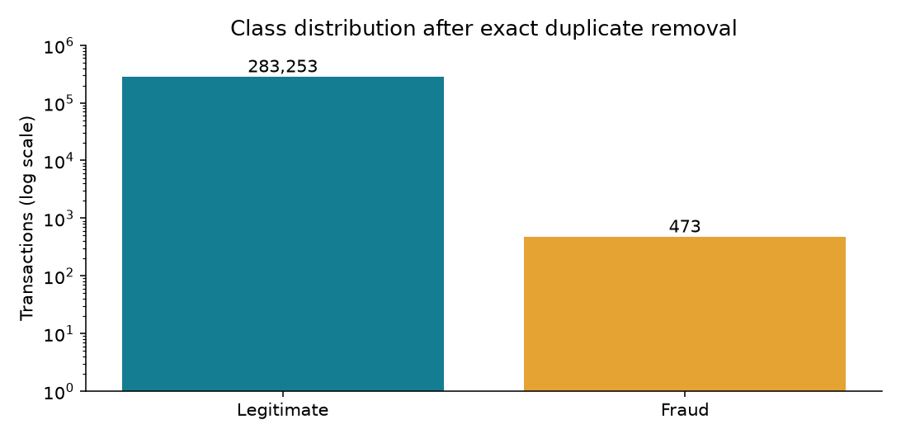
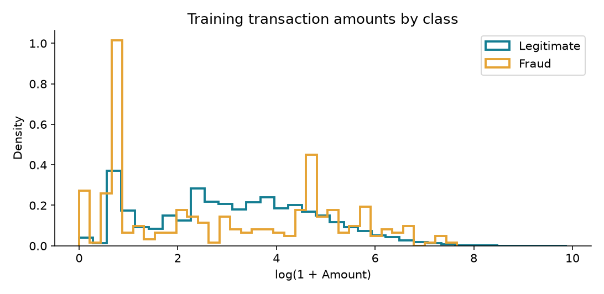
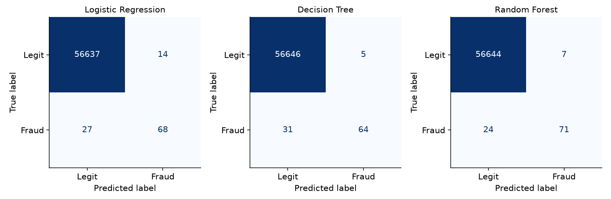
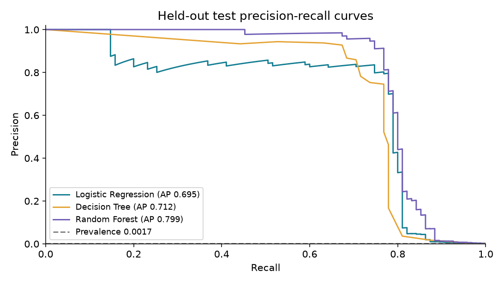
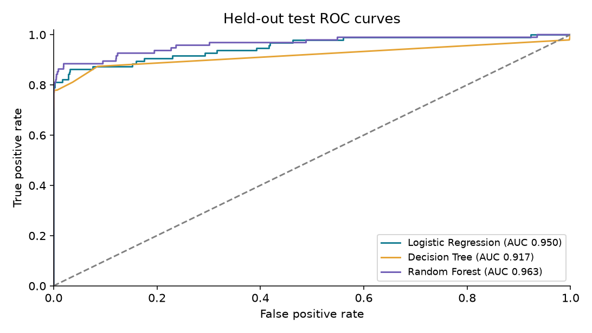
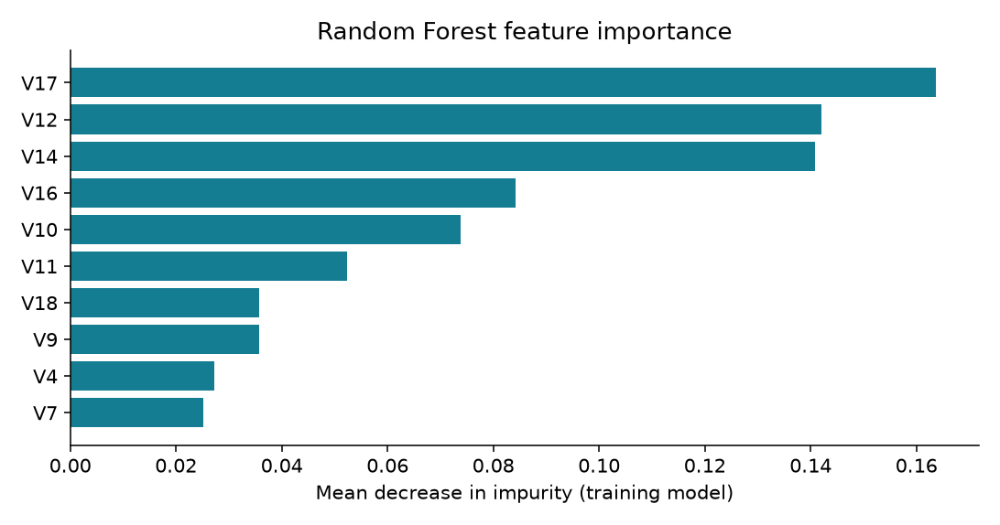

Comparison of Logistic Regression, Decision Tree, and Random Forest for identifying potentially fraudulent credit card transactions.

Sagar Khadka

Bipin Adhikari

Bardan Karki

Samiksha Rijal

Samin Rijal

## Abstract

This investigation applies three supervised classification algorithms to the recommended Credit Card Fraud Detection dataset. After removing 1,081 exact duplicate rows, 283,726 transactions remain, including 473 fraud cases. A stratified 60% training, 20% validation, and 20% test design separates fitting, model selection, and final evaluation. Each algorithm is evaluated with and without balanced class weights. Validation average precision selects the weighting treatment within each algorithm, and validation F1 determines its threshold and the recommended model family.

The validation-selected recommendation is Random Forest. On the held-out test set, it achieves precision 0.910, recall 0.747, F1 0.821, and average precision 0.799. It detects 71 of 95 fraud cases with 7 false alerts. Results support a benchmark comparison, with important limits from the small number of fraud cases, anonymous features, and a random rather than chronological split.

Analysis date: November 7, 2026. Project code supplied by the team. The assignment PDF calls this Topic 5. Contribution records require team confirmation.

# 1. Problem and objectives

The problem is binary classification: distinguish potentially fraudulent transactions from legitimate transactions using the available transaction characteristics. Missing fraud and incorrectly flagging a legitimate purchase are different errors. The evaluation therefore measures both fraud detection and false alerts.

## Research question

Among Logistic Regression, Decision Tree, and Random Forest, which provides the strongest validation F1 after selecting class weighting by average precision and tuning its decision threshold, and how does that frozen choice perform on unseen transactions?

## Objectives

Describe the data and inspect quality issues, class imbalance, and relevant distributions.

Implement and compare three appropriate algorithms using reproducible preprocessing and identical data partitions.

Measure the effect of balanced class weights and explain the decision-threshold trade-off.

Evaluate accuracy, precision, recall, F1, confusion matrices, ROC-AUC, and average precision, then justify a recommendation.

Discuss feature importance, uncertainty, dataset limitations, and future improvements.

## Scope and baseline

The target is Class, with 1 denoting fraud and 0 denoting legitimate transactions. The project evaluates an offline benchmark, not a live payment-blocking service. F1 is the study objective because no verified fraud cost or investigation capacity was supplied. It balances precision and recall, but it does not minimize a known monetary loss.

An always-legitimate classifier achieves 99.833% test accuracy while detecting zero fraud cases. This baseline demonstrates why accuracy alone cannot support a fraud-detection recommendation.

## Distinctive approach

The study combines exact duplicate removal, an explicit weighting comparison, validation-only threshold selection, and honest test evaluation. If another team uses the same dataset, confirm that this question and approach are meaningfully different, as required by the assignment.

# 2. Dataset and exploratory review

The original source is the ULB Machine Learning Group Credit Card Fraud Detection dataset on Kaggle [1]. The file used here comes from the public mirror referenced in TensorFlow's official tutorial [2]. The source describes European credit card transactions from September 2013. V1 through V28 are anonymized principal components, while Time and Amount retain their original meanings [1].

| Property | Observed value |
| --- | --- |
| Original rows / fraud | 284,807 / 492 |
| Cleaned rows / fraud | 283,726 / 473 |
| Predictors / target | 30 predictors / Class |
| Missing values / exact duplicate rows | 0 / 1,081 |
| Cleaned fraud prevalence | 0.1667% |

| Columns | Type and interpretation |
| --- | --- |
| Time | Numeric: seconds elapsed from the first transaction |
| V1 to V28 | Numeric: anonymized PCA components; original meanings unavailable |
| Amount | Numeric: transaction amount |
| Class | Integer binary label: 0 legitimate, 1 fraud |

Figure 1. Class imbalance after exact duplicate removal. A log scale makes the minority class visible.

The full per-column count, mean, standard deviation, quantiles, range, dtype, and missing count are available in results/data_dictionary.csv. All values are numeric and finite. No categorical encoding is needed.

# 3. Preprocessing and data partitions

Exact duplicate rows were removed before splitting to prevent identical records from appearing in multiple partitions. This removes 1,081 rows, including 19 fraud-labeled duplicates. Identical rows could represent separate real events, so deduplication is an explicit modeling assumption. No missing values, non-finite values, negative amounts, or negative times were found.

All 30 predictors are retained. No feature selection, synthetic oversampling, undersampling, or outlier deletion is performed. Unusual transactions can carry useful fraud signals. Time is retained as an available benchmark feature, but may encode patterns that do not transfer to a later period. The supplied PCA components are used as released; their original fitting procedure cannot be audited.

Logistic Regression uses a StandardScaler fitted only on training data inside a pipeline. The trees use the unscaled numeric inputs because their splits operate on feature ordering. Scaling effects were not separately ablated. Balanced class weights alter the training objective without changing validation or test prevalence [3].

| Split | Transactions | Legitimate | Fraud |
| --- | --- | --- | --- |
| Train | 170,235 | 169,951 | 284 |
| Validation | 56,745 | 56,651 | 94 |
| Test | 56,746 | 56,651 | 95 |

The initial split reserves 20% for testing. The remaining 80% is divided 75/25 into training and validation, yielding approximately 60/20/20 overall. Both splits are stratified by Class and use random seed 42. This leaves validation data for threshold choice while preserving a separate final test set. Split row identities are saved for audit.

Figure 2. Training-only amount distributions. The log transform is for visualization; models use Amount as documented above.

A random split tests generalization within this historical sample. It does not simulate predicting future transactions or prevent unknown cardholder overlap. A chronological evaluation is an important next experiment.

# 4. Algorithms and experiment design

| Algorithm | Why appropriate | Configuration |
| --- | --- | --- |
| Logistic Regression | Linear classification reference; standardized coefficients support inspection. | C=1; L2 default; lbfgs; max_iter=2000; StandardScaler |
| Decision Tree | Models nonlinear rules and interactions; controlled complexity reduces overfitting. | max_depth=8; min_samples_leaf=10; Gini default |
| Random Forest | Averages diverse trees to reduce single-tree variance and capture nonlinear interactions. | 150 trees; max_depth=16; min_samples_leaf=2; max_features=sqrt; bootstrap default |

Each algorithm is fit twice: class_weight=None and class_weight="balanced". Balanced weighting gives minority examples greater training influence based on inverse class frequency. All six fits use the same training partition. Random state is 42. Random Forest uses four workers; elapsed times are machine dependent. The full constructor settings are in source/run_analysis.py.

## Selection procedure fixed before test evaluation

1. Fit each candidate on the training partition only.

2. Within each algorithm, select the weighting treatment with the highest validation average precision (AP). This evaluates score ranking across thresholds.

3. For that candidate, select the threshold that maximizes validation F1. Predictions use score >= threshold; ties in F1 choose the highest threshold.

4. Recommend the algorithm with the highest selected validation F1.

5. Freeze models and thresholds, then evaluate all three on the test partition. Do not refit on validation data, because that could shift the score scale underlying the chosen threshold.

## Metric definitions

Precision = TP/(TP+FP): the fraction of alerts that are fraud. Recall = TP/(TP+FN): the fraction of fraud found. F1 = 2PR/(P+R). Accuracy = (TP+TN)/N. ROC-AUC summarizes ranking against the false-positive rate. AP summarizes precision as recall increases; it is the scikit-learn average_precision_score, not trapezoidal area under the precision-recall curve [4].

No broad hyperparameter search or cross-validation was conducted. Depth, leaf size, and tree count were fixed for a tractable semester baseline. The small validation set can make threshold selection unstable, and its optimized F1 is not an unbiased final performance estimate. Only the separate test results serve that purpose [5, 6].

# 5. Validation and class weighting

| Algorithm | Weights | AP | Best F1 | Threshold |
| --- | --- | --- | --- | --- |
| Logistic Regression | None | 0.8023 | 0.7979 | 0.11694361 |
| Logistic Regression | balanced | 0.7876 | 0.8462 | 0.99999992 |
| Decision Tree | None | 0.8305 | 0.8276 | 0.80000000 |
| Decision Tree | balanced | 0.4764 | 0.6791 | 0.99926761 |
| Random Forest | None | 0.8780 | 0.8865 | 0.34966667 |
| Random Forest | balanced | 0.8671 | 0.8757 | 0.51232243 |

Table 1. Validation results for six candidates. Each F1 uses that candidate's validation-optimal threshold. Weighting is selected by AP, so the candidate with the highest threshold-specific F1 need not be selected.

Logistic Regression: balanced weighting changes validation AP by -0.0147. The selected treatment is None, with threshold 0.11694361 and validation F1 0.7979.

Decision Tree: balanced weighting changes validation AP by -0.3541. The selected treatment is None, with threshold 0.80000000 and validation F1 0.8276.

Random Forest: balanced weighting changes validation AP by -0.0108. The selected treatment is None, with threshold 0.34966667 and validation F1 0.8865.

## Why weighting may not improve performance

Class weighting changes how errors influence fitting, but can also increase false alerts or change score calibration. Its effect is empirical rather than guaranteed. In this experiment, the validation ranking metric determines whether the weighting treatment is retained. Scores from weighted models should not automatically be interpreted as calibrated fraud probabilities.

## Recommendation before opening the test results

Random Forest has the highest F1 among the selected validation candidates. That rule establishes the recommendation before test evaluation. Test results are reported for comparison without using them to retune thresholds or replace the preselected model.

The balanced Logistic Regression threshold can lie extremely close to 1. This reflects the score distribution and weighting, not near-certain real-world fraud probabilities. The full-precision thresholds are retained in the results files.

# 6. Held-out test results

| Algorithm | Accuracy | Precision | Recall | F1 | AP | ROC-AUC |
| --- | --- | --- | --- | --- | --- | --- |
| Logistic Regression | 0.99928 | 0.8293 | 0.7158 | 0.7684 | 0.6950 | 0.9503 |
| Decision Tree | 0.99937 | 0.9275 | 0.6737 | 0.7805 | 0.7119 | 0.9174 |
| Random Forest | 0.99945 | 0.9103 | 0.7474 | 0.8208 | 0.7991 | 0.9635 |

Table 2. Final test metrics at validation-selected thresholds. Precision, recall, and F1 refer to fraud (Class=1), not macro or weighted averages.

| Algorithm | True negatives | False alerts | Missed fraud | Fraud found |
| --- | --- | --- | --- | --- |
| Logistic Regression | 56637 | 14 | 27 | 68 |
| Decision Tree | 56646 | 5 | 31 | 64 |
| Random Forest | 56644 | 7 | 24 | 71 |

Table 3. Confusion counts on 56,746 test transactions, including 95 fraud cases. Rows of each confusion matrix below are actual classes; columns are predicted classes.

Figure 3. Confusion matrices for the three selected models.

## Measured comparison

Random Forest has the highest observed test F1 (0.8208). The preselected recommendation, Random Forest, finds 71 fraud cases, misses 24, and generates 7 false alerts. Its 78 alerts correspond to 13.7 alerts per 10,000 transactions.

The recommended model's recall is 74.7%, with an approximate 95% Wilson interval of 65.2% to 82.4%. This interval conditions on the fixed model and treats the 95 fraud outcomes as independent trials. It does not include model-selection uncertainty or temporal dependence.

# 7. Ranking performance and thresholds

Figure 4. Precision-recall curves computed from test scores. AP measures ranking independently of the chosen threshold.

Figure 5. ROC curves. High ROC-AUC alone can hide an operationally costly number of false alerts in a large legitimate class.

The precision-recall view directly emphasizes minority-class detection. The dashed prevalence line is a reference for uninformative ranking. These curves describe the frozen models on the test data; they are not used to choose new operating points.

# 8. Interpretation and limitations

## Default versus selected thresholds

| Algorithm | Test F1 at 0.5 | Test F1 at selected threshold |
| --- | --- | --- |
| Logistic Regression | 0.6957 | 0.7684 |
| Decision Tree | 0.7647 | 0.7805 |
| Random Forest | 0.8263 | 0.8208 |

Table 4. A descriptive threshold comparison. Both the default threshold and the selection procedure were defined before test evaluation. Threshold choice changes alert volume and error balance; it does not change the model's score ranking or AP.

Random Forest has slightly higher test F1 at 0.5 (0.8263) than at the selected threshold (0.8208). Lowering its threshold finds two additional fraud cases but adds four false alerts. This illustrates that validation tuning need not improve test F1. The recommendation retains the validation-selected threshold rather than choosing a new one using test results.

## Feature importance

The five largest Random Forest impurity importances are V17 (0.164), V12 (0.142), V14 (0.141), V16 (0.084), V10 (0.074). These describe how the fitted trees reduce training impurity. They are not causal effects and can favor features with more possible splits. The anonymized component names prevent explanations in terms of original customer characteristics.

Figure 6. Top ten Random Forest feature importances. Coefficients for standardized Logistic Regression predictors are also supplied.

An ensemble can outperform a single tree by averaging unstable decisions, while a linear model may miss interactions. These are plausible explanations, not established causal findings. Fixed hyperparameters, weighting treatment, and limited validation fraud examples can all affect the observed ranking.

Limits: one historical dataset; only 95 test fraud cases; one random split; unknown customer grouping; released PCA transformation; no probability calibration; no chronological evaluation; no measured review cost or monetary-loss model. Exact duplicate removal changes the population. Results do not demonstrate current banking performance or fairness across demographic groups.

# 9. Conclusion and reproducibility

This project implements three algorithms for credit card fraud classification and evaluates them beyond accuracy. The validation procedure recommends Random Forest. Its test precision of 0.9103, recall of 0.7474, and F1 of 0.8208 support its use as the strongest candidate under this study's selection rule. The result is a benchmark recommendation, not a production deployment decision.

The main finding is that meaningful fraud evaluation requires class-specific metrics and an explicit threshold policy. Class weighting must be measured rather than assumed beneficial. A model with nearly perfect accuracy can still miss many fraud cases, while higher recall may increase unnecessary investigations.

Future work should evaluate chronological splits, repeated or nested validation, threshold stability, permutation importance, calibration, and decision thresholds based on documented review capacity or loss costs. Additional data spanning later periods would test drift and external validity. No unperformed experiment is presented as a completed result.

## Reproduction instructions

Use Python 3.12. Install requirements.txt, then run: python source/run_analysis.py. The script downloads the dataset if data/creditcard.csv is absent. For a local file, use --data PATH. Use python source/build_report.py to regenerate this report after results exist. README.md documents the full workflow, and the notebook provides an interactive entry point.

The delivered metrics and figures were produced by the included script. results/test_predictions.csv supports independent metric recomputation, results/split_assignments.csv identifies the exact partitions, and results/summary.json records the data fingerprint and software versions. Hardware-dependent timing can vary.

## Dataset provenance

Original source: https://www.kaggle.com/datasets/mlg-ulb/creditcardfraud

Download mirror: https://storage.googleapis.com/download.tensorflow.org/data/creditcard.csv

SHA-256: 76274b691b16a6c49d3f159c883398e03ccd6d1ee12d9d8ee38f4b4b98551a89

Recorded environment: Python 3.12.14; numpy 2.3.5, pandas 3.0.1, scikit-learn 1.9.1, matplotlib 3.11.2, scipy 1.18.1, joblib 1.6.0.

## Team contribution record

Team members: Sagar Khadka, Bipin Adhikari, Bardan Karki, Samiksha Rijal, Samin Rijal. Actual individual contributions were not provided. CONTRIBUTIONS.md contains suggested responsibilities and an unfilled confirmation table. It must be updated to describe work each member actually completed. The code, analysis, report, and presentation were prepared with AI assistance; the team must review and understand them before presenting.

# References

[1] ULB Machine Learning Group. Credit Card Fraud Detection. Kaggle.

https://www.kaggle.com/datasets/mlg-ulb/creditcardfraud

[2] TensorFlow. Classification on imbalanced data. Dataset mirror and imbalance context.

https://www.tensorflow.org/tutorials/structured_data/imbalanced_data

[3] scikit-learn. RandomForestClassifier. Class weighting and estimator parameters.

https://scikit-learn.org/stable/modules/generated/sklearn.ensemble.RandomForestClassifier.html

[4] scikit-learn. average_precision_score. AP definition.

https://scikit-learn.org/stable/modules/generated/sklearn.metrics.average_precision_score.html

[5] scikit-learn. Common pitfalls and recommended practices. Data leakage and pipelines.

https://scikit-learn.org/stable/common_pitfalls.html

[6] scikit-learn. Tuning the decision threshold for class prediction.

https://scikit-learn.org/stable/modules/classification_threshold.html

All web references accessed November 7, 2026. Assignment source: Machine Learning Team Project - Student.pdf, supplied by the user, especially Topic 5 and the general requirements on pages 8-14.

## Evidence files

Dataset quality: results/data_dictionary.csv. Validation experiment: results/validation_candidates.csv. Final comparison: results/test_metrics.csv. Default thresholds: results/test_default_threshold.csv. Full scores and predictions: results/test_predictions.csv. Feature analysis: results/random_forest_importance.csv and results/logistic_coefficients.csv.
